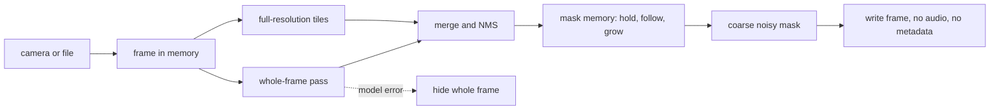

# Parda पर्दा

Parda hides faces and number plates in photos and video before anyone else sees them. It runs on your own device: in a browser tab, on a laptop, or on a Raspberry Pi 5 dashcam that masks every frame before it is saved.

**Try it:** [23f1000270.github.io/parda](https://23f1000270.github.io/parda/) (camera, photo or video; nothing is uploaded)

## Why we built it

Road video is the raw material for road-safety research and driver-assistance systems. In India it is also full of personal data. Under the Digital Personal Data Protection Act, 2023, faces and number plates identify people, which makes sharing Indian road footage risky for dashcam owners, researchers and startups. Less shared footage means less open data, and AI for Indian roads falls further behind.

Good open tools for this already exist, such as Meta's [EgoBlur](https://github.com/facebookresearch/EgoBlur) and [dashcamcleaner](https://github.com/tfaehse/dashcamcleaner). They were built and tested mostly on Western roads. Indian roads add two-line plates, plates on two-wheelers and autos, yellow commercial and green EV plates, BH-series and hand-painted plates, helmeted riders and dense crowds at night. Parda is built and measured for those conditions.

## What it does

* **Finds faces and plates on-device.** YuNet for faces and a YOLO11n plate model we fine-tuned on Indian plates, both running on ONNX Runtime. Nothing leaves the machine.
* **Scans twice.** One pass over the whole frame for large objects, then full-resolution tiles so small faces in a crowd and distant plates are not shrunk to nothing. Photos in the browser get both passes; the CLI can do both on every video frame.
* **Masks so it cannot be undone.** Blur and fine pixelation can be partly reversed by learned models ([McPherson et al., 2016](https://arxiv.org/abs/1609.00408)). Parda replaces each region with at most six cells of averaged colour plus random noise.
* **Remembers what flickers.** Detectors miss objects for a frame or two. Parda keeps masking a lost face or plate for eight more frames, moves the mask along its last motion and grows it each frame, so uncertainty always gets a bigger mask, never a smaller one.
* **Fails closed.** If a model crashes on a frame, that whole frame is hidden.
* **Drops what else identifies you.** Saved videos have no audio track and no metadata, so voices and the GPS tracks many dashcams embed are gone too. Saved photos carry no EXIF.
* **Masks at capture.** In live mode, frames are masked in memory and only then written, so the raw video never exists on disk. If the device falls behind, it drops frames rather than saving them unmasked. Live mode is tested with webcams and video streams; Raspberry Pi 5 camera tests are under way.



## Use it

```bash
pip install git+https://github.com/23f1000270/parda
parda fetch-models                     # downloads and checksums the models

parda image photos/ -o blurred/        # a folder of photos
parda video drive.mp4 -o drive_safe.mp4
parda video drive.mp4 -o drive_safe.mp4 --thorough   # also tile-scan for distant plates
parda live --source picamera2 --out-dir rec/          # Raspberry Pi 5 camera
parda live --source 0 --preview --seconds 30          # any webcam
```

From Python:

```python
import cv2
from parda import Anonymizer

anon = Anonymizer()
result = anon.process(cv2.imread("street.jpg"), use_memory=False)
cv2.imwrite("street_safe.jpg", result.image)
```

Every model is fetched once and checked against a pinned SHA-256 before it is loaded. You can also pass another plate model, such as `--plate-model plate-yolov9t-640` or your own `my_model.onnx`. [train/](train/README.md) has everything used to build the Indian plate model, so you can retrain it on your own data.

## How we measure it

Detection benchmarks reward tight boxes. Privacy asks a different question: after masking, how much of each face or plate can still be seen? So `parda bench` reports:

* **Protected recall at t:** the share of labelled faces and plates with at least a fraction t of their area masked (we report t = 0.80 and 0.95).
* **Over-mask:** how much of the frame was masked outside any labelled object, which is the picture quality we gave up.

Both are broken down by every label attribute: plate type and colour, vehicle, face view, object size, light and weather. Any other tool can be scored the same way from a JSON of the regions it masked. See [data/README.md](data/README.md) for the test set protocol.

**First results: plates.** We fine-tuned the plate model on eight public Indian plate datasets, after removing duplicates and holding out 650 test photos (718 plates) that no copy of went into training. At the same over-mask, it protects more plates than the model it replaced:

| Plate model | Protected at 80% | Large plates | Over-mask | Time per frame |
|---|---:|---:|---:|---:|
| YOLOv9-t 640 (previous Python default) | 78.8% | 68.9% | 1.19% | 100 ms |
| YOLOv9-t 384 (previous browser default) | 81.5% | 72.7% | 1.53% | 46 ms |
| **Indian YOLO11n 384 (now default)** | **87.9%** | **81.8%** | 1.53% | 40 ms |

A plate counts as protected when at least 80% of it is masked. Times are per frame on a two-core cloud CPU.

The biggest gain is on two-wheeler, auto and EV plates photographed up close. It is not better everywhere: on the easiest group of test photos it is a point behind. The full breakdown, the method and the limits are in [train/README.md](train/README.md).

These test photos are mostly phone pictures of parked vehicles. Our own dashcam test set from Indian roads, with faces as well as plates, is being collected now. We will publish numbers for Parda and EgoBlur on it, including the cases where Parda loses.

## Known limits

* YuNet is weak on faces in profile, from behind and under helmets. A person-detector fallback that masks the head region is next on the list.
* The plate model sometimes masks text that looks like a plate. That costs a little picture, not privacy.
* The browser video mode masks one fast pass per frame and records in real time, so slow devices drop frames. Use the CLI for full-quality output.
* Parda reduces risk; it is not a legal compliance guarantee. Check what your use of the footage requires.

## Roadmap

1. ~~Plate model fine-tuned on Indian plates.~~ Done, see [train/README.md](train/README.md).
2. Dashcam test set from Indian roads and results for faces and plates.
3. Head fallback for helmeted riders and back-of-head views.
4. Measured frame rates on Raspberry Pi 5 and NVIDIA Jetson.

## Project layout

```
parda/        Python package: detectors, mask memory, masks, video, live capture, benchmark
site/         the in-browser demo (ONNX Runtime Web, no build step)
train/        how the Indian plate model was built: data cleaning, training, evaluation
data/         test set protocol and labelling guide
tests/        pytest suite
```

## Licence

Apache-2.0 for Parda's code. The face model and the original plate models are MIT. The fine-tuned plate model is AGPL-3.0 because it was trained with Ultralytics; `--plate-model plate-yolov9t-640` switches to an MIT model. Details and dataset credits are in [NOTICE.md](NOTICE.md).
